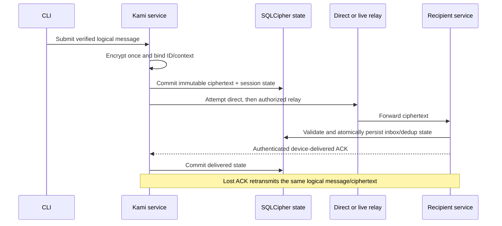

# KAMI-51 Cryptographic Provider Comparison

Status: Research complete; provider selection remains pending the M1 feasibility gate and owner decision.

Research date: 2026-10-21
Repository branch observed: `identity-security`
Required Rust toolchain observed: `rustc 1.98.1`

This document is a standalone Kami repository research report. It does not modify the canonical requirements, Jira, Obsidian, production Rust code, Cargo manifests, Cargo.lock, or Git metadata.

## 1. Executive summary

Kami M1 needs more than a library that can encrypt bytes. It needs a maintained Rust implementation of an authenticated one-to-one session, plus safe integration with verified device identities, libp2p Peer IDs, encrypted SQLite, durable retries, receipts, and crash recovery.

The current canonical requirements explicitly call for an established Signal-style authenticated session-establishment design and Double Ratchet message-key progression.[1] Signal's published specifications describe X3DH as an asynchronous authenticated key agreement using pre-published key material, and the Double Ratchet as a per-message key progression with additional Diffie-Hellman ratcheting.[2][3]

The research conclusion is deliberately conservative:

1. No candidate is a drop-in, defensible KAMI-51 M1 solution.
2. `libsignal` is the closest protocol match, but its upstream says use outside Signal is unsupported, its supported products are Java, Swift, and TypeScript wrappers around Rust implementations, its APIs may change without notice, and it is AGPL-3.0.[4] It is therefore blocked pending legal and support/API decisions.
3. `vodozemac` is the strongest permissively licensed Rust one-to-one ratchet building block: pure Rust, Apache-2.0, maintained, and publicly associated with a Least Authority audit.[5][6] It is an Olm implementation rather than a Signal wire implementation, but the approved M1 text requires Signal-style authenticated Double Ratchet security rather than Signal wire interoperability. It therefore remains a conditional candidate, subject to a Kami-owned authenticated Olm profile and integration proof.
4. `OpenMLS` is the strongest standards-based future group candidate. `mls-rs` is a credible alternative. Neither is equivalent to Signal's Double Ratchet: both implement MLS/RFC 9420, a group key-establishment protocol with epochs, commits, welcomes, and key packages.[7][8][9]
5. Wire Proteus and CoreCrypto contain useful engineering reference material, especially around asynchronous ratcheting and encrypted persistence, but GPL-3.0 licensing, Wire-specific assumptions, and uncertain general-purpose support make them poor default Kami dependencies.[10][13]

Recommended next decision: approve a bounded implementation path for the conditional vodozemac provider profile, using the completed basic feasibility evidence and targeting only unresolved profile, persistence, and platform qualification gaps. Keep libsignal as a legal/support contingency and OpenMLS/mls-rs as future group-provider candidates. Signal wire interoperability would be a separate owner decision; it is not an approved M1 requirement found in the canonical documents reviewed here.

### Plain-language terms

- Forward secrecy: compromise of current keys should not reveal previously protected messages.
- Post-compromise security: after a compromise ends and the protocol advances, later messages can become secure again.
- Pre-key: public key material published in advance so an initiator can start a session while the recipient is offline.
- Double Ratchet: two parties repeatedly advance symmetric chains and periodically mix in fresh Diffie-Hellman values; this gives fresh message keys and recovery after later exchanges.[3]
- MLS: Messaging Layer Security, an IETF group protocol designed for asynchronous groups from two to thousands, with epochs, commits, forward secrecy, and post-compromise security.[7]
- Replay protection: preventing an attacker or retry from causing an already accepted message or state transition to be accepted again.
- Rollback: restoring or loading older cryptographic state in a way that reuses keys, accepts stale messages, or forks the session.

## 2. Scope, evidence, and confidence

### 2.1 Sources and evidence method

The investigation read `AGENTS.md`, `Kami_Project_Requirements.md`, `Kami_Communication_Design.md`, `docs/architecture/Identity_And_Encryption.md`, and `docs/architecture/Messaging_Protocol.md`. The current repository working tree contained substantial pre-existing changes; those were preserved.

Primary upstream repositories, release pages, protocol specifications, crate metadata, audit references, and security pages were reviewed where available. Current repository and crate metadata observed during research included:

| Candidate | Current version evidence observed | License evidence | Maintenance evidence | Audit/security evidence |
|---|---|---|---|---|
| OpenMLS | crates.io `0.9.1`; GitHub release `0.9.0` page | MIT | 2,000+ commits; active main branch | GHSA-gc79-23g3-8g52 affects `<0.8.2` and `0.9.0`, patched in `0.8.2`/`0.9.1`; other listed advisories require separate range checks |
| mls-rs | crates.io `0.56.0` | Apache-2.0 OR MIT | active repository; 900+ commits observed | repository explicitly says no full third-party security audit |
| libsignal | no stable general-purpose Rust crate version used as selection evidence | AGPL-3.0 | 4,000+ commits; active repository | no current whole-reusable-provider audit evidence found in reviewed primary material |
| vodozemac | `0.11.1` | Apache-2.0 | active repository; current release activity | Current security page lists two low advisories affecting `<0.7.0` and `0.5.0`/`0.5.1`; neither range includes `0.11.1` |
| Wire Proteus | repository release history; current general-purpose crates.io version not established | GPL-3.0 | active repository but older protocol lineage | historical Wire/X41/Kudelski review; not current-version certification |
| Wire CoreCrypto | repository release activity; exact selected version not established | GPL-3.0; Wire trademark restrictions also apply | very active, large product repository | no current whole-component independent audit established in reviewed material |
| Nostr Double Ratchet | active MIT repository observed | MIT | active but small project | no comparable independent audit evidence found; screened out |

A fact is labeled `Verified` when supported directly by an upstream page, protocol specification, release/manifest, or local canonical file. `Judgment` means architectural assessment. `Unknown` means the reviewed evidence did not establish the claim; it is not scored silently as zero.

### 2.2 Jira KAMI-51 reconciliation

The authenticated Atlassian MCP read used `mcp__atlassian__getJiraIssue` with the resolved Kami cloud ID and `view: "evidence"`. KAMI-51 is a High-priority Task in `To Do`, under KAMI-2, with labels `backlog`, `e2ee`, `fm`, `identity`, `implementation`, and `security`.

The exact Jira objective is to integrate the selected maintained authenticated Signal-style/Double-Ratchet session profile for FM. Its scope requires validation of the maintained Rust implementation, licensing, interoperability, supported platforms, and session profile; authenticated sessions bound to verified device identities and message context; crash-safe ratchet/session persistence; immutable logical-message identity and safely persisted retry ciphertext across direct/relay retries and lost ACKs; receive-side ratchet advancement, replay/skipped-message handling, and transaction boundaries with KAMI-22 storage; and fail-closed behavior if no defensible maintained implementation/profile is available.[22]

Jira assigns boundaries as follows: KAMI-21 owns structural codec validation; KAMI-23 owns device identity/key custody; KAMI-50 owns contact trust and Peer-ID binding; KAMI-22 owns persistence primitives; KAMI-24/KAMI-25 consume the session contract; and KAMI-28/KAMI-30 integrate direct/relayed delivery. Jira lists KAMI-21, KAMI-22, KAMI-23, and KAMI-50 as dependencies. Its verification list is provider/interoperability review, authenticated session vectors, crash/restart, replay/skipped-message, lost-ACK, retry-ciphertext, key-change, and cross-platform tests.

The Jira issue does not require Signal wire interoperability. Its wording confirms that the report's distinction between Signal-style security properties and Signal's specific wire protocol is correct. This report's limited next path therefore reconciles with KAMI-51: provider/profile validation first, then integration with the named boundary owners, without changing Jira or canonical requirements.

## 3. Kami requirements baseline

### 3.1 Mandatory M1 requirements

The following are mandatory constraints from the owner-approved canonical documents:

- Rust-only implementation.
- Linux, Windows, and macOS support demonstrated rather than inferred.
- One active device per participant identity in M1.
- Explicit fingerprint verification; no silent trust-on-first-use.
- KAMI-23 device identity with OS-backed key custody and fail-closed behavior if unavailable.
- KAMI-50 verified-contact and Peer-ID binding: the verified device identity must be bound to the authenticated rust-libp2p Peer ID.
- Signal-style authenticated session establishment and Double Ratchet message-key progression.[1]
- Direct P2P first, authorized live relay fallback, with relay forwarding but no relay plaintext access.
- No mandatory central messaging server and no server-side offline mailbox in M1.
- Sender-side encrypted durable outbox until delivery or explicit cancellation.
- Stable logical message ID across transport changes and retries.
- Exact safe retransmission semantics after a lost ACK.
- Replay protection, duplicate suppression, conflicting-ID rejection, bounded out-of-order handling, and visible gaps.
- Durable recipient persistence before a device-delivered ACK.
- Crash-safe persistence of session/ratchet state, inbox, outbox, receipts, and deduplication state.
- SQLCipher/encrypted SQLite for local sensitive state, with WAL, journal, temporary, backup, and logging exposure considered.
- No custom cryptographic primitives or unreviewed custom protocol.

No provider supplies all of these application contracts. A provider is one component of the identity/E2EE manager, not the message engine, transport manager, or encrypted database.

### 3.2 Future objectives

Future scope includes multiple devices, secure backup/recovery, organizations, group conversations, encrypted attachments, durable recipient offline mailboxes, agent adapters, scoped agent permissions, and eventually federation.[1] MLS is especially relevant to future groups, but future usefulness does not override the current M1 protocol requirement.

### 3.3 Requirements that would need revision for an MLS M1 choice

Choosing MLS for M1 would require an explicit owner-approved revision of at least:

1. `MSG-04` and the corresponding Identity and Encryption specification: replace the approved Signal-style authenticated session plus Double Ratchet direction with an MLS profile, or explicitly define a two-member MLS profile as satisfying the security requirement.
2. The communication architecture's `Double Ratchet` ownership and session lifecycle.
3. The messaging protocol's ratchet-state and retransmission contract, replacing it with an MLS epoch/commit/application-message model while preserving stable logical IDs and exact retransmission.
4. The identity specification's session-establishment language, including the mapping from verified device credentials to MLS credentials and key packages.
5. M1 acceptance tests for prekeys, skipped message keys, ratchet restart, and session establishment, replacing or supplementing them with key-package, welcome, commit, epoch rollback, and stale-commit tests.
6. The offline and delivery assumptions: MLS normally relies on delivery-service semantics for distributing key packages and protocol messages, while Kami M1 explicitly retains undelivered messages only in the sender's local outbox.

This report does not modify those requirements.

## 4. Longlist and initial screening

### 4.1 Shortlisted candidates

- OpenMLS: maintained Rust MLS implementation; strong future group candidate.
- mls-rs: maintained Rust MLS implementation; strong future group alternative.
- libsignal: closest Signal-style protocol semantics; blocked by support, licensing, and API risks.
- vodozemac/Olm: maintained pure-Rust asynchronous one-to-one ratchet building block; protocol interoperability differs from Signal.
- Wire Proteus: asynchronous Axolotl/Double Ratchet implementation; GPL and historical/product-specific risks.
- Wire CoreCrypto: Wire's larger MLS/Proteus/persistent-storage subsystem; product-specific GPL integration reference.

### 4.2 Significant alternatives screened out

- Generic `double-ratchet` crates: generally low-level ratchet APIs that assume the caller supplies authenticated session setup, identity, persistence, framing, and replay policy. No reviewed evidence established the complete security and maintenance profile required for M1.
- Small Signal-derived or personal Rust crates: excluded unless they demonstrate maintained upstream activity, an interoperable authenticated prekey profile, versioned state serialization, audit evidence, and Linux/Windows/macOS support. A crate that merely exposes `encrypt` and `decrypt` is not a complete E2EE provider.
- Nostr Double Ratchet: technically interesting and MIT-licensed, with active work and durable pairwise concepts, but small-project scale and lack of comparable independent audit/interoperability evidence make it unsuitable as a default M1 dependency.[17] It remains a research reference, not a scored finalist.
- libolm: superseded for new Rust integration by vodozemac and not a Rust-native long-term choice.

## 5. Detailed candidate profiles

## 5.1 libsignal

### Verified facts

Signal's specifications cover X3DH and Double Ratchet.[2][3] The libsignal repository contains Rust implementations used by official Signal clients and servers, including `libsignal-protocol`, and describes Java, Swift, and TypeScript as the supported platform-agnostic APIs.[4] The README explicitly states that use outside Signal is unsupported and that APIs may change without notice.[4] The repository is AGPL-3.0.[4]

The repository documents published native artifacts for Debian-flavored x86_64 Linux, Windows x86_64, macOS x86_64/arm64, Android, and Node. It describes Windows/Linux arm64 as experimental.[4] This is useful platform evidence but not proof of a supported general-purpose native Rust service API.

### Security and identity

This is the closest candidate to the approved M1 protocol family. Signal-style session establishment supports asynchronous prekeys, identity authentication, forward secrecy, and ratchet-based post-compromise recovery in the protocol model.[2][3] libsignal still does not provide Kami's independently verified fingerprint workflow, KAMI-23 key custody, KAMI-50 Peer-ID binding, or relay policy.

Audit coverage for the exact reusable Rust API and selected commit was not established in the reviewed primary material. `Unknown` is not a claim that libsignal is unaudited; it means no applicable current whole-provider audit was verified here.

### Reliability and persistence

libsignal's official client ecosystem has mature session-store concepts, but no reviewed source proves atomic coupling between a Kami SQLCipher transaction, ratchet state mutation, immutable ciphertext outbox record, and device-delivered receipt. Kami must prove that a crash cannot advance a sending chain while losing the only retransmission material, and cannot emit a delivery state before durable recipient persistence.

### Judgment

Protocol fit: strongest. Independent-provider support, license, API stability, and integration fit: weak. `BLOCKED` pending legal review, upstream support/API decision, exact commit qualification, and a crash-safe storage proof.

## 5.2 vodozemac / Olm

### Verified facts

vodozemac is a pure Rust implementation of Olm and Megolm, Apache-2.0 licensed, with a high-level API and a current observed version of `0.11.1`.[5] The project links a Least Authority audit and states that it found no significant findings.[5][6] The API exposes Olm accounts, identity material, one-time/fallback prekeys, asynchronous pre-key sessions, message encryption/decryption, and serializable account/session state.[11]

### Security and identity

Olm is a one-to-one ratchet with asynchronous pre-key establishment, so the shape maps well to M1. It is not Signal/X3DH wire-compatible. Kami would need a written protocol profile for identity signatures, prekey lifecycle, associated-data/context binding, fingerprint derivation, session authentication, and Peer-ID association.

Megolm is available for Matrix group semantics, but its group/session properties are not a reason to select it as Kami's future group protocol. A later group design should compare MLS independently.

The audit is evidence, not blanket certification. For the observed `0.11.1` release, the current vodozemac security page lists GHSA-j8cm-g7r6-hfpq, affecting versions `<0.7.0` and patched in `0.7.0`, and GHSA-c3hm-hxwf-g5c6, affecting `0.5.0` and `0.5.1`; neither published affected range includes `0.11.1`.[19] This does not prove that all transitive dependencies or Kami integration are secure; it means these two published advisories were not confirmed as affecting the pinned crate version. No claim is made here about an advisory without a confirmed affected range.

### Reliability and persistence

Serialized account/session state is useful but is not a transaction protocol. vodozemac does not provide Kami message IDs, immutable encrypted outbox rows, recipient inbox/deduplication, device-delivered ACKs, or bounded presentation gaps. Kami must own all of these.

A safe design must encrypt once, durably store the ciphertext and application binding, then transmit. If a retry must use the same ciphertext, the provider/session state transition must be coordinated so that retransmission does not incorrectly advance or reuse state. This is a feasibility question, not an assumption.

### Judgment

Best permissive Rust building block for a small M1 one-to-one feasibility profile, but not a drop-in provider. Conditional recommendation only after the existing basic feasibility evidence is combined with a written Kami Olm profile and targeted integration qualification. Signal wire interoperability is not required by the reviewed canonical M1 text and must not be introduced as an implicit gate.

## 5.3 OpenMLS

### Verified facts

OpenMLS implements MLS as specified by RFC 9420 and is MIT-licensed.[8] The repository has more than 2,000 commits and exposes crypto-provider and storage-provider abstractions, including SQLite-related support.[8] The observed release page identifies `0.9.0` and raises MSRV to Rust 1.91.[8] The separate crates.io metadata observed during research reports `0.9.1`.[18]

MLS is an asynchronous group key-establishment protocol. RFC 9420 describes groups from two to thousands, forward secrecy, and post-compromise security, with state changes represented by proposals, commits, epochs, and ratchet-tree updates.[7]

OpenMLS reports an SRLabs/Phoenix audit history.[14] The current security page's published ranges were checked against `0.9.1`: GHSA-gc79-23g3-8g52 affects `<0.8.2` and `0.9.0`, patched in `0.8.2` and `0.9.1`; GHSA-w62v-gv48-63rh and GHSA-rrmv-c79f-cf5r affect `<0.9.0`; GHSA-8x3w-qj7j-gqhf affects `<0.7.2`; and GHSA-qr9h-x63w-vqfm affects `0.7.0` only.[20][21] On those published ranges, none of the listed advisories affects `0.9.1`. This is not a clean bill of health: audit coverage of `0.9.1`, alternate providers, storage crates, transitive dependencies, and Kami integration remains unresolved.

### Security, identity, and persistence

MLS credentials can carry custom identity material, so binding a Kami device identity to an MLS credential is feasible. Binding it to the authenticated libp2p Peer ID remains application-owned.

OpenMLS's storage model is substantial, but persisted state is not automatically a tamper-proof secure database. The documentation warns about trusted storage assumptions and transaction/cancellation concerns. Kami still needs authenticated state integrity, SQLCipher/WAL handling, crash-safe commit ordering, rollback detection, and key deletion qualification.

### Reliability and M1 fit

MLS authenticates application messages within an epoch, but it does not provide Kami's stable logical message ID, exact ciphertext retransmission, sender outbox, device-delivered ACK semantics, relay failover, or bounded visible sequence gaps. Those remain above MLS.

### Judgment

Leading future group candidate. Not recommended for current M1 without a formal owner-approved MLS requirements revision. Weighted score is not a license to bypass the mandatory protocol gate.

## 5.4 mls-rs

### Verified facts

mls-rs implements MLS/RFC 9420, supports custom credentials and extensions, configurable storage, SQLite, and WASM. The observed crate version was `0.56.0`; the crate declares Apache-2.0 OR MIT.[9] Its repository security notice states that it has been validated for RFC conformance but has not received a full third-party security audit.[9]

The project advertises multiple crypto backends. The evaluator review notes that the RustCrypto provider is described as experimental in current documentation,[15] while other options may add native build and packaging complexity.

### Security and integration

The same MLS/M1 mismatch as OpenMLS applies. Custom credentials can carry Kami identity references, but the Peer-ID binding, fingerprint workflow, storage integrity, retry, outbox, receipt, and relay contracts remain Kami work.

### Judgment

Credible future MLS alternative, with lower security confidence than OpenMLS because the project explicitly lacks a full third-party audit. Not an M1 Signal-style provider.

## 5.5 Wire Proteus

### Verified facts

Proteus implements the Axolotl protocol, later renamed Double Ratchet, without header keys. It uses prekeys for asynchronous setup and documents ChaCha20, HMAC-SHA256, Curve25519, HKDF, libsodium primitives, and CBOR serialization.[10] The repository is GPL-3.0.[10]

A historical Wire/X41/Kudelski review provides useful scrutiny, but its age and dependency/version scope do not certify current code or a Kami integration.[12]

### Security and reliability

The one-to-one prekey/ratchet shape is technically relevant. The protocol is Wire-specific and not Signal-compatible. Current support, exact API stability, current independent audit applicability, secure memory behavior, and target qualification remain incomplete or unknown.

Serialization is not crash-safe transaction coupling. Kami still owns identity binding, message IDs, outbox-before-send, inbox-before-ACK, duplicate/conflicting-content handling, and ordering.

### Judgment

Reject as default. Retain as historical/reference material only unless GPL-3.0 and Wire protocol compatibility become explicit owner decisions.

## 5.6 Wire CoreCrypto

### Verified facts

CoreCrypto is Wire's Rust MLS/Proteus multiplexer abstraction with encrypted persistent storage, keystore support, and FFI/platform bindings.[13] The repository is GPL-3.0 and includes a Wire trademark restriction.[13] It is a large, actively changing product subsystem rather than a narrow cryptographic crate.

### Security and integration

CoreCrypto is valuable architectural reference material because it combines protocol selection, persistence, and bindings.[16] It does not prove that its transaction boundaries satisfy Kami's exact ciphertext retransmission, outbox-before-send, inbox-before-ACK, or direct/relay semantics. The exact selected branch/version must be inspected before any claim about Proteus availability; the evaluator noted that some CoreCrypto architecture material describes Proteus as unsupported in a referenced version.

### Judgment

Useful reference or possible fork only after legal review and a dedicated ownership plan. Not recommended as a direct M1 dependency.

## 6. Protocol architecture differences

### 6.1 Signal-style sessions

A typical Signal-style deployment separates asynchronous session establishment from ongoing messaging. Public identity keys, signed prekeys, and one-time prekeys allow an initiator to establish a session while the recipient is offline.[2] The Double Ratchet then derives fresh message keys and periodically mixes new DH values.[3]

This maps naturally to Kami's one-to-one M1 scope, but the library still does not define Kami's Peer-ID binding, direct/relay selection, durable outbox, message ID, ACK meaning, or SQLCipher transaction.

### 6.2 MLS

MLS is designed for group evolution. Members publish key packages, join via welcomes, and advance group state through proposals and commits. Epochs and ratchet-tree updates support scalable group forward secrecy and post-compromise security.[7]

A two-member MLS group is possible, but it is not merely Signal with two members. It changes state, delivery, asynchronous provisioning, persistence, protocol framing, and recovery semantics. It can be the right future group protocol without being the right M1 protocol.

### 6.3 Olm

Olm is Matrix's one-to-one asynchronous ratchet. It offers a convenient Rust implementation and prekey-based setup, but adopts Matrix's identity and wire profile rather than Signal's.[11] Selecting it means choosing a Kami-specific Olm profile, not claiming Signal wire interoperability. Because the current canonical M1 requirement names a Signal-style authenticated profile rather than a Signal wire format, vodozemac remains conditionally compatible; its recommendation depends on proving the Kami-owned profile and integration contracts, not on adopting Signal's wire protocol.

### 6.4 Core message/retry invariant

Regardless of provider, Kami must preserve this sequence:

This is an integration architecture, not a property supplied by any reviewed candidate.

## 7. Weighted scoring matrix

### 7.1 Scoring method

Each criterion has an individual score from 0 to 5. The weight is not a score: it determines the criterion's maximum contribution to the 100-point total. Weighted contribution is `criterion weight × score / 5`. The displayed totals are arithmetic comparisons, not approvals. Scores are provisional where audit, version, security, support, or integration evidence is unresolved; confidence and specific unknowns are stated below. Unknown evidence is not silently converted to zero.

Weights:

| Criterion | Weight |
|---|---:|
| Cryptographic security and independent audits | 25% |
| Identity authentication and trust integration | 15% |
| Reliability, retries, and out-of-order messages | 15% |
| Maintenance and library maturity | 10% |
| Rust and cross-platform support | 10% |
| Kami architecture compatibility | 10% |
| Future extensibility | 5% |
| Licensing and sustainability | 5% |
| Implementation complexity | 5% |

### 7.2 Matrix

| Candidate | Security score (0–5) | Identity score (0–5) | Reliability score (0–5) | Maintenance score (0–5) | Rust/platform score (0–5) | Kami-fit score (0–5) | Future score (0–5) | License score (0–5) | Complexity score (0–5) | Weighted contribution (points/100) | Gate status |
|---|---:|---:|---:|---:|---:|---:|---:|---:|---:|---:|---|
| libsignal | 4 | 4 | 4 | 5 | 3 | 2 | 5 | 1 | 2 | 72.0 | BLOCKED: unsupported external use/API and AGPL review |
| OpenMLS | 4 | 3 | 3 | 5 | 4 | 2 | 5 | 5 | 2 | 72.0 | BLOCKED: M1 protocol mismatch |
| vodozemac | 3 | 3 | 3 | 4 | 4 | 3 | 3 | 5 | 3 | 66.0 | CONDITIONAL: feasible building block, not drop-in |
| mls-rs | 2 | 3 | 3 | 4 | 4 | 2 | 5 | 5 | 3 | 61.0 | BLOCKED: M1 protocol mismatch and no full audit |
| CoreCrypto | 2 | 3 | 4 | 4 | 3 | 3 | 4 | 1 | 1 | 57.0 | BLOCKED: GPL/product-specific integration |
| Proteus | 2 | 3 | 3 | 2 | 3 | 3 | 2 | 1 | 3 | 50.0 | BLOCKED: GPL, historical/product-specific risk |

### 7.3 Score rationale and confidence

| Candidate | Criterion evidence and judgment | Confidence |
|---|---|---|
| libsignal | Security 4: closest mature protocol family, but exact reusable API audit coverage is Unknown. Identity 4: strong protocol identity model, but Kami binding is absent. Reliability 4: mature client/session concepts, but Kami atomic retry coupling is unverified. Maintenance 5: highly active. Rust/platform 3: native artifacts exist, but general Rust API is unsupported. Kami fit 2: significant adapter ownership. Future 5: multi-device and Signal ecosystem are strong. License 1: AGPL is a major constraint. Complexity 2: high integration and upgrade burden. | Medium |
| OpenMLS | Security 4: standards implementation and audit history, but release/provider/storage applicability is conditional. Identity 3: custom credentials feasible; Peer-ID binding absent. Reliability 3: storage abstractions and protocol authentication help, but exact retry/ACK semantics are absent. Maintenance 5: active and mature. Rust/platform 4: broad documented targets, exact Kami matrix unverified. Kami fit 2: MLS/M1 mismatch. Future 5: strongest group fit. License 5: MIT. Complexity 2: MLS integration is substantial. | Medium-High |
| vodozemac | Security 3: named audit and maintained pure Rust, but audit/version/advisory applicability needs pinning. Identity 3: prekeys and identity material exist; Kami trust binding absent. Reliability 3: ratchet and serialization exist; outbox/ACK/rollback semantics absent. Maintenance 4: active Matrix project. Rust/platform 4: pure Rust; OS/key-store qualification remains Unknown. Kami fit 3: one-to-one ratchet shape maps, but protocol is not Signal. Future 3: Megolm exists but does not settle Kami groups. License 5: Apache-2.0. Complexity 3: moderate but security-critical glue. | Medium |
| mls-rs | Security 2: conformance evidence but no full third-party audit. Identity 3: custom credentials feasible. Reliability 3: storage/provider abstractions, but application semantics absent. Maintenance 4: active. Rust/platform 4: Rust/WASM/SQLite and provider options, native dependency qualification remains. Kami fit 2: MLS mismatch. Future 5: strong future groups. License 5: permissive dual license. Complexity 3: moderate-to-high MLS integration. | Medium |
| CoreCrypto | Security 2: substantial product integration but no current whole-component audit established. Identity 3: product identity assumptions differ from Kami. Reliability 4: encrypted persistence and multiplexer are useful evidence, exact Kami invariants unverified. Maintenance 4: active but moving. Rust/platform 3: broad bindings but product-native complexity. Kami fit 3: closest integrated architecture, but Wire assumptions. Future 4: MLS and migration concepts. License 1: GPL/trademark constraints. Complexity 1: difficult to adopt as a narrow dependency. | Low-Medium |
| Proteus | Security 2: ratchet/prekey design with historical audit evidence, but old/product-specific scope. Identity 3: prekeys support setup; Kami binding absent. Reliability 3: serialization and ratchet, but transaction/retry semantics absent. Maintenance 2: less convincing long-term general-purpose trajectory. Rust/platform 3: Rust and libsodium/native concerns. Kami fit 3: one-to-one shape. Future 2: not a strong group path. License 1: GPL. Complexity 3: moderate but bespoke. | Medium-Low |

The equal 72.0 totals for libsignal and OpenMLS do not mean they are interchangeable. Both fail different mandatory gates: libsignal fails support/legal/provider usability gates; OpenMLS fails the currently approved M1 protocol-family gate.

## 8. Mandatory security and compatibility gates

A candidate is `BLOCKED` or `DISQUALIFIED` regardless of weighted score if it fails any applicable gate:

| Gate | Required evidence | Current result |
|---|---|---|
| Approved M1 protocol family | Signal-style authenticated setup plus Double Ratchet, or explicit owner-approved requirements revision | OpenMLS/mls-rs blocked; vodozemac conditionally compatible as a non-Signal Olm profile; libsignal closest protocol-family match |
| Security evidence | Version/commit-specific advisory ranges, audit scope, and remediation applicability | OpenMLS `0.9.1` and vodozemac `0.11.1` have confirmed published-range results above; complete audit/dependency coverage remains unresolved |
| License/distribution | Legal acceptance of dependency and transitive licenses | libsignal/Proteus/CoreCrypto blocked pending review |
| No unsupported integration assumption | Upstream support for the intended embedding/API and usable state/serialization surface | libsignal explicitly blocked; CoreCrypto/Proteus product-specific; vodozemac/OpenMLS/mls-rs require qualification |

These are provider-selection gates. They decide whether a candidate may proceed to a Kami-owned integration design; they do not claim that the candidate already satisfies Kami's complete messaging system.

### 8.1 Post-selection integration and native release qualification

The following are later implementation and release-qualification obligations, not reasons to misstate a provider's protocol or audit status:

- authenticate Kami identities and bind KAMI-50 fingerprints to Peer IDs;
- atomically persist provider state, immutable ciphertext, inbox/outbox, receipts, and deduplication records;
- prove exact logical-message retransmission after lost ACKs;
- bound skipped-key and out-of-order resources and reject conflicting IDs;
- qualify Linux, Windows, and macOS builds, OS key stores, locked-key behavior, SQLCipher/WAL/backups, and native dependencies;
- exercise direct-to-relay path switching, restart, rollback, malformed input, and receipt failures.

The existing basic vodozemac feasibility evidence should be reused. The next implementation path should target the unresolved profile and integration gaps rather than repeat that basic exercise.

## 9. Integration architecture for strongest candidates

### 9.1 Narrow provider boundary

Kami should define a narrow internal boundary, without exposing provider-specific state through the message engine:

- identity public/private material and authenticated peer descriptors;
- prekey generation, publication, consumption, and rotation;
- session establishment and authenticated peer checking;
- encrypt/decrypt with explicit associated-data/context input;
- skipped-key limits and out-of-order behavior;
- serialization/versioning of provider state;
- explicit state transition results suitable for a database transaction;
- zeroization and error classification.

The following must remain outside the provider:

- KAMI-23 OS credential-store adapters;
- KAMI-50 fingerprint verification and Peer-ID binding records;
- Protobuf message IDs and sequence numbers;
- SQLCipher schema, WAL/backup handling, outbox/inbox/deduplication;
- device-delivered receipts;
- direct/relay path selection and admission policy;
- retry scheduling, queue pressure, and visible ordering gaps.

### 9.2 vodozemac feasibility profile

The feasibility profile must specify:

1. Which vodozemac identity keys authenticate the session and how they bind to the verified Kami device descriptor.
2. How prekeys are generated, advertised, consumed, replenished, and revoked.
3. Exact associated-data encoding for conversation ID, sender/recipient device identity, Peer ID binding, message ID, and protocol version.
4. Maximum skipped keys and memory/queue bounds.
5. Session pickle/version format and migration policy.
6. How ciphertext is persisted before network transmission and how state behaves after crash at every transition point.
7. Whether retransmission uses the same ciphertext and how the provider avoids an unsafe second ratchet advance.
8. How identity replacement blocks existing queued messages.
9. Linux, Windows, and macOS build/key-store qualification.

### 9.3 libsignal feasibility path

If retained, the libsignal path requires an explicit legal/support decision and must pin an upstream commit. The proof must establish:

- supported embedding boundary rather than merely compiling internal Rust crates;
- API and serialization stability expectations;
- license obligations for Kami's distribution model;
- session-store integration and atomic ratchet/outbox coupling;
- target-specific native artifact/build support;
- identity and Peer-ID binding without relying on Signal service assumptions;
- upgrade ownership if upstream changes break internal APIs.

### 9.4 Future MLS boundary

OpenMLS or mls-rs should be evaluated later behind the same provider boundary. A future MLS profile should own key packages, credentials, welcomes, commits, epochs, and group state. It must not be forced into the M1 message-engine semantics without explicitly preserving stable IDs, retry, delivery ACK, and sender-side offline retention.

## 10. Advantages, disadvantages, and unresolved risks

### vodozemac

Advantages: Apache-2.0; pure Rust; one-to-one asynchronous ratchet shape; current maintenance; public audit reference; smaller integration surface than a complete product subsystem.

Disadvantages: not Signal-compatible; Kami owns profile and identity integration; serialization is not transactional persistence; no complete application messaging semantics; future groups remain a separate design.

Unresolved risks: exact audit/version applicability, advisory status, bounded skipped-key behavior, crash-safe retransmission, and three-OS key-store integration.

### libsignal

Advantages: closest approved protocol family; mature ecosystem; strong one-to-one and multi-device pedigree; active upstream.

Disadvantages: AGPL-3.0; upstream unsupported for use outside Signal; APIs may change; intended wrappers are Java/Swift/TypeScript; native Rust CLI integration is not a supported contract; substantial integration ownership.

Unresolved risks: legal posture, upstream support, exact commit/API stability, audit applicability, and atomic state/retry design.

### OpenMLS/mls-rs

Advantages: standards-based future groups; permissive licensing; custom credentials; provider/storage abstractions; asynchronous key-package model.

Disadvantages: not Signal/Double Ratchet; group epoch/commit complexity; no Kami delivery/retry semantics; audit/support differences; persistence integrity remains integration work.

Unresolved risks: owner approval for an MLS M1 revision, exact version/audit mapping, SQLCipher and OS qualification, and offline sender-only delivery semantics.

### Wire implementations

Advantages: real product experience with ratchet/MLS migration and encrypted persistence; useful reference architectures.

Disadvantages: GPL-3.0; Wire-specific assumptions; trademark restrictions for CoreCrypto; larger moving product surface; historical audit scope; unclear independent general-purpose support.

Unresolved risks: exact supported version, Proteus availability in selected CoreCrypto branch, legal obligations, and whether a fork would be required.

## 11. Required minimal feasibility tests

Before production implementation, run a disposable, out-of-tree proof for the selected candidate(s):

1. Establish two independently generated device identities.
2. Verify fingerprints through a test trust action; reject unverified sends.
3. Bind the verified device identity to a test Peer ID; reject wrong Peer IDs.
4. Establish a session with recipient prekey material while the recipient is offline.
5. Encrypt one logical message and persist its ciphertext before transport.
6. Crash after encryption, before outbox commit; verify no unsafe state is accepted.
7. Crash after outbox commit, before send; verify exact retransmission.
8. Crash after provider state advancement, before durable ciphertext state; verify the design fails safely rather than losing or reusing message material.
9. Lose the ACK and retransmit the same logical message; verify one inbox record and successful ACK replay.
10. Replay the ciphertext; verify duplicate suppression.
11. Reuse the ID with conflicting content; verify rejection.
12. Deliver messages out of order and exhaust the skipped-key bound; verify bounded resource use and visible gap behavior.
13. Restart both endpoints and restore encrypted state from SQLCipher/WAL/backup conditions.
14. Replace the identity key unexpectedly; verify queued messages remain blocked.
15. Force direct failure and authorized relay fallback; verify identical application ciphertext and E2EE.
16. Exercise locked/unavailable OS key storage on Linux, Windows, and macOS.
17. Run malformed, oversized, stale, forged-receipt, wrong-recipient, wrong-context, and rollback cases.

A same-crate encrypt/decrypt self-test is not sufficient evidence for these requirements.

## 12. Recommendation and owner decisions

### Recommendation

Do not claim final provider selection yet. The limited implementation path is:

- freeze a narrow `E2eeProvider` interface and a Kami-owned Olm session profile around the already completed vodozemac basic-feasibility evidence;
- implement only the provider adapter, identity/session binding, durable state transition hooks, and targeted missing integration tests listed in Section 8.1;
- run the required architecture, security, and release qualification reviews before calling the provider M1-ready;
- retain libsignal as a contingency requiring separate legal and upstream-support resolution;
- retain OpenMLS and mls-rs for future groups, and Proteus/CoreCrypto as reference material.

This recommendation is conditional because vodozemac is not Signal wire-compatible and no candidate has yet demonstrated every Kami integration contract. Signal wire interoperability is not an approved M1 requirement in the canonical documents reviewed; if the owner later adds it, the provider decision must be reopened rather than silently treating Olm as interoperable.

### Owner decisions required

1. Authorize the limited vodozemac-provider implementation path above, without repeating the completed basic feasibility tests and without changing canonical requirements.
2. Is AGPL-3.0 acceptable for the intended Kami distribution and deployment model? If not, libsignal and Wire candidates remain excluded.
3. If future interoperability is desired, decide separately whether Signal wire interoperability is required; it is not presumed by the current M1 wording.
4. Preserve the current Signal-style M1 requirement while reserving MLS for future groups; this is the recommended direction.

## 13. Sources

[1] Kami canonical requirements and specifications: repository files `docs/Kami_Project_Requirements.md`, `docs/Kami_Communication_Design.md`, `docs/architecture/Identity_And_Encryption.md`, and `docs/architecture/Messaging_Protocol.md`.

[2] Signal, X3DH specification: https://signal.org/docs/specifications/x3dh/

[3] Signal, Double Ratchet specification: https://signal.org/docs/specifications/doubleratchet/

[4] Signal libsignal repository, README, support statement, platform notes, and license: https://github.com/signalapp/libsignal

[5] Matrix vodozemac repository and README, version/license/security notes: https://github.com/matrix-org/vodozemac

[6] Least Authority, Matrix vodozemac audit reference: https://matrix.org/media/Least%20Authority%20-%20Matrix%20vodozemac%20Final%20Audit%20Report.pdf

[7] IETF RFC 9420, The Messaging Layer Security Protocol: https://www.rfc-editor.org/rfc/rfc9420.html

[8] OpenMLS repository/releases: https://github.com/openmls/openmls and https://github.com/openmls/openmls/releases

[9] AWS Labs mls-rs repository, crate metadata, and security notice: https://github.com/awslabs/mls-rs and https://crates.io/crates/mls-rs

[10] Wire Proteus repository: https://github.com/wireapp/proteus

[11] vodozemac Olm API documentation: https://matrix-org.github.io/vodozemac/vodozemac/olm/index.html

[12] Wire historical X41/Kudelski review: https://www.x41-dsec.de/reports/Kudelski-X41-Wire-Report-phase1-20170208.pdf

[13] Wire CoreCrypto repository and architecture: https://github.com/wireapp/core-crypto

[14] OpenMLS audit and security material: https://blog.phnx.im/openmls-independent-security-audit/ and https://github.com/openmls/openmls/security

[15] mls-rs documentation: https://awslabs.github.io/mls-rs/ and https://docs.rs/mls-rs/latest/mls_rs/

[16] Wire CoreCrypto documentation: https://wireapp.github.io/core-crypto/

[17] Nostr Double Ratchet alternative screened out: https://github.com/irislib/nostr-double-ratchet

[18] OpenMLS crates.io metadata: https://crates.io/api/v1/crates/openmls

[19] vodozemac GitHub security advisories and confirmed affected ranges: https://github.com/matrix-org/vodozemac/security/advisories/GHSA-j8cm-g7r6-hfpq and https://github.com/matrix-org/vodozemac/security/advisories/GHSA-c3hm-hxwf-g5c6

[20] OpenMLS GHSA-gc79-23g3-8g52 advisory and confirmed affected/patched ranges: https://github.com/openmls/openmls/security/advisories/GHSA-gc79-23g3-8g52

[21] Other current OpenMLS advisories and confirmed ranges: https://github.com/openmls/openmls/security/advisories/GHSA-w62v-gv48-63rh, https://github.com/openmls/openmls/security/advisories/GHSA-rrmv-c79f-cf5r, https://github.com/openmls/openmls/security/advisories/GHSA-8x3w-qj7j-gqhf, and https://github.com/openmls/openmls/security/advisories/GHSA-qr9h-x63w-vqfm

[22] Jira KAMI-51 evidence read through authenticated Atlassian MCP: https://pql7227.atlassian.net/browse/KAMI-51
