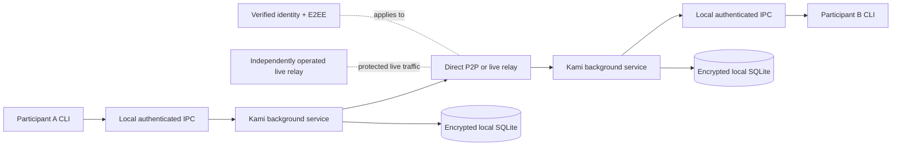

# Kami Architecture Home

Kami is a communication-first platform for secure communication between people and AI agents. The canonical documents define the intended requirements and architecture. The repository currently contains documentation only: no Rust workspace, crate, module, or test implementation exists yet.

## Navigate the architecture

- [[01 — System Architecture/System Boundaries]] — system boundaries and component responsibilities.
- [[02 — Module Architecture/Module Architecture]] — intended Rust crate/module organization and interfaces.
- [[03 — Communication Flows/Communication Flows]] — message, identity, transport, relay, and service flows.
- [[04 — Security and Identity/Security and Identity]] — identity, verification, E2EE, key protection, and trust boundaries.
- [[05 — Data and State/Data and State]] — durable entities, inbox/outbox, receipts, and state transitions.
- [[06 — Runtime and Deployment/Runtime and Deployment]] — service lifecycle, CLI/IPC, operating systems, and topology.
- [[07 — Implementation Map/Implementation Map]] — evidence-based implemented versus architecturally defined capabilities.
- [[07 — Implementation Map/Kami Implementation Dependencies]] — native Canvas of Jira Epics, tasks, and dependencies.
- [[07 — Implementation Map/Epic Hierarchy Map]] — Jira capability hierarchy; membership is not a blocker.
- [[07 — Implementation Map/Milestone 1 Dependency Graph]] — complete M1 Jira dependency graph.
- [[07 — Implementation Map/Core Protocol Storage]] — protocol and persistence workstream.
- [[07 — Implementation Map/Identity Trust E2EE]] — identity, trust, and session workstream.
- [[07 — Implementation Map/Delivery Transport Relays]] — delivery and networking workstream.
- [[07 — Implementation Map/Integration Runtime Qualification]] — runtime and qualification workstream.
- [[Reference/Architecture Sources]] — canonical sources and maintenance boundary.
- [[Reference/Glossary]] — shared terminology.

## High-level system

The services own networking and durable state. The CLIs are local clients. Direct delivery is preferred; authorized live relays forward protected online traffic and are not offline mailboxes. See [[01 — System Architecture/System Boundaries]], [[03 — Communication Flows/Communication Flows]], and [[06 — Runtime and Deployment/Runtime and Deployment]].

## Status legend

- **Implemented:** demonstrated by current repository source and verification evidence.
- **Partially implemented:** source exists, but the architectural capability is incomplete or unverified.
- **Architecturally defined:** required or designed in canonical documentation, with no repository implementation evidence.
- **Deferred:** outside the current M1 boundary.

Current repository evidence places the major Kami capabilities in the **architecturally defined** category, not implemented.

## Source boundary

Canonical requirements and architecture are linked from [[Reference/Architecture Sources]]. This vault explains relationships and flows; it does not replace the canonical documents or Jira.