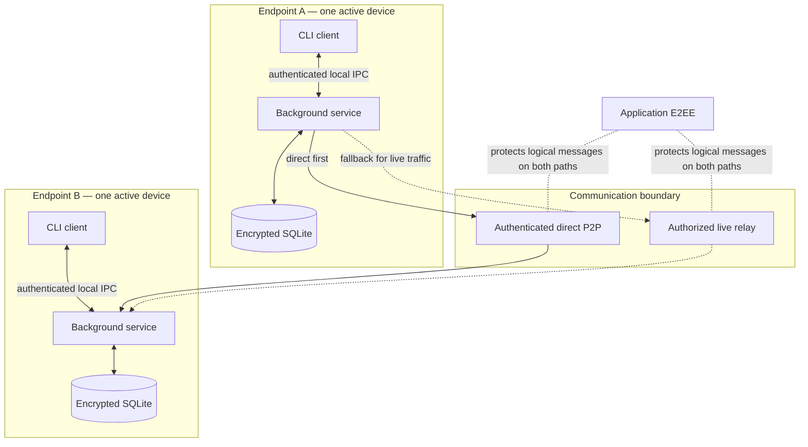

# System Boundaries

## Components

| Component | Responsibility | Boundary |
| --- | --- | --- |
| CLI client | User-facing commands, status, and local requests | Does not own networking or durable message state |
| Background service | Identity, persistence, sessions, transport, retry, and delivery orchestration | Runs locally for one active device |
| Encrypted SQLite state | Durable inbox, outbox, history, receipts, deduplication, ordering, and session state | Local endpoint only |
| Direct transport | Authenticated endpoint-to-endpoint delivery | Preferred path; depends on reachability |
| Live relay | Forwards protected online traffic | No offline mailbox and no recipient authentication authority |
| Identity/E2EE boundary | Verified participant/device identity and application encryption | Applies across direct and relayed paths |

## Current versus future

M1 covers verified one-to-one human-operated CLI endpoints, one active device per participant, bounded private text, encrypted local state, direct P2P, supported NAT traversal, and authorized live-relay fallback. Server-side offline mailboxes, groups, artifacts, agent task execution, federation, and multi-device recovery are future extensions, not current components.

Related: [[02 — Module Architecture/Module Architecture]], [[03 — Communication Flows/Communication Flows]], [[04 — Security and Identity/Security and Identity]], [[06 — Runtime and Deployment/Runtime and Deployment]].