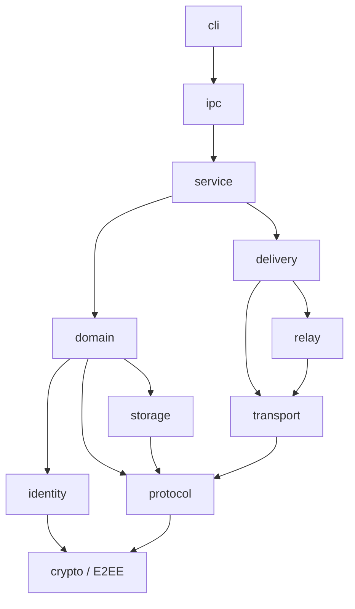

q
# Module Architecture

No Rust workspace or source modules are present in the current repository. The map below is therefore a planned architectural decomposition, not an inventory of existing crates.

## Intended crate/module boundaries

## Responsibilities and interfaces

- **`cli`** — translates user commands into local service requests and renders truthful state; it does not access network or database internals directly.
- **`ipc`** — authenticated, bounded local request/response boundary using Unix domain sockets or Windows named pipes.
- **`service`** — owns startup, shutdown, orchestration, resource limits, and background workers.
- **`domain`** — logical identities, conversations, messages, delivery facts, and state transitions.
- **`identity`** — participant/device identity, verification ceremony, and verified identity to libp2p Peer ID binding.
- **`crypto` / E2EE** — maintained Signal-style session establishment and Double Ratchet message protection; no custom cryptography.
- **`protocol`** — versioned Protobuf frames, message identity, authorization context, receipts, and encoded-size bounds.
- **`storage`** — encrypted SQLite persistence, migrations, outbox/inbox/history, receipts, deduplication, ordering, and session state.
- **`delivery`** — durable enqueue, direct-first selection, relay fallback, retry, reconnect, and receipt handling.
- **`transport`** — authenticated direct P2P, preferred QUIC with TCP alternative, and supported NAT traversal.
- **`relay`** — live relay admission, candidate selection, authenticated relayed sessions, and failover; no offline storage.

These are conceptual ownership boundaries. They must not be reported as implemented until source and verification evidence exists. Related: [[07 — Implementation Map/Implementation Map]], [[04 — Security and Identity/Security and Identity]], and [[05 — Data and State/Data and State]].