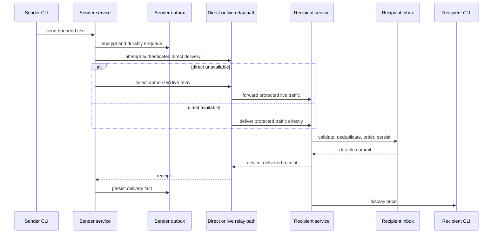

# Communication Flows

## Direct-first message delivery

## Connected flows

- [[03 — Communication Flows/Contact Verification]] — verified identity precedes private messaging.
- [[03 — Communication Flows/Relay Fallback and Retry]] — direct path, relay candidates, reconnect, and outbox retry.
- [[03 — Communication Flows/Service Lifecycle]] — background service startup and shutdown.
- [[04 — Security and Identity/Security and Identity]] — identity and E2EE constraints applied to every path.
- [[05 — Data and State/Data and State]] — durable state and receipt transitions.

The logical message ID, authorization meaning, E2EE protection, and receipt semantics remain stable when the network path changes. An undelivered message remains in the sender's encrypted local outbox; M1 has no server-side offline mailbox.