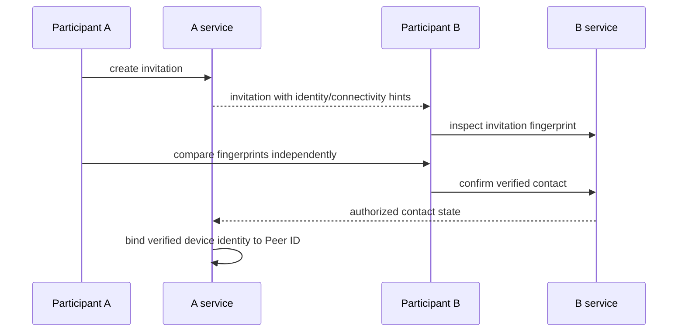

# Contact Verification

Invitations may carry public identity and connectivity hints, but those values are untrusted until both parties compare and verify fingerprints through an independent channel.

Unknown or changed keys block private messaging until reverification. Display names, addresses, relay admission, and self-signatures are not identity proof. Related: [[04 — Security and Identity/Security and Identity]] and [[02 — Module Architecture/Module Architecture]].