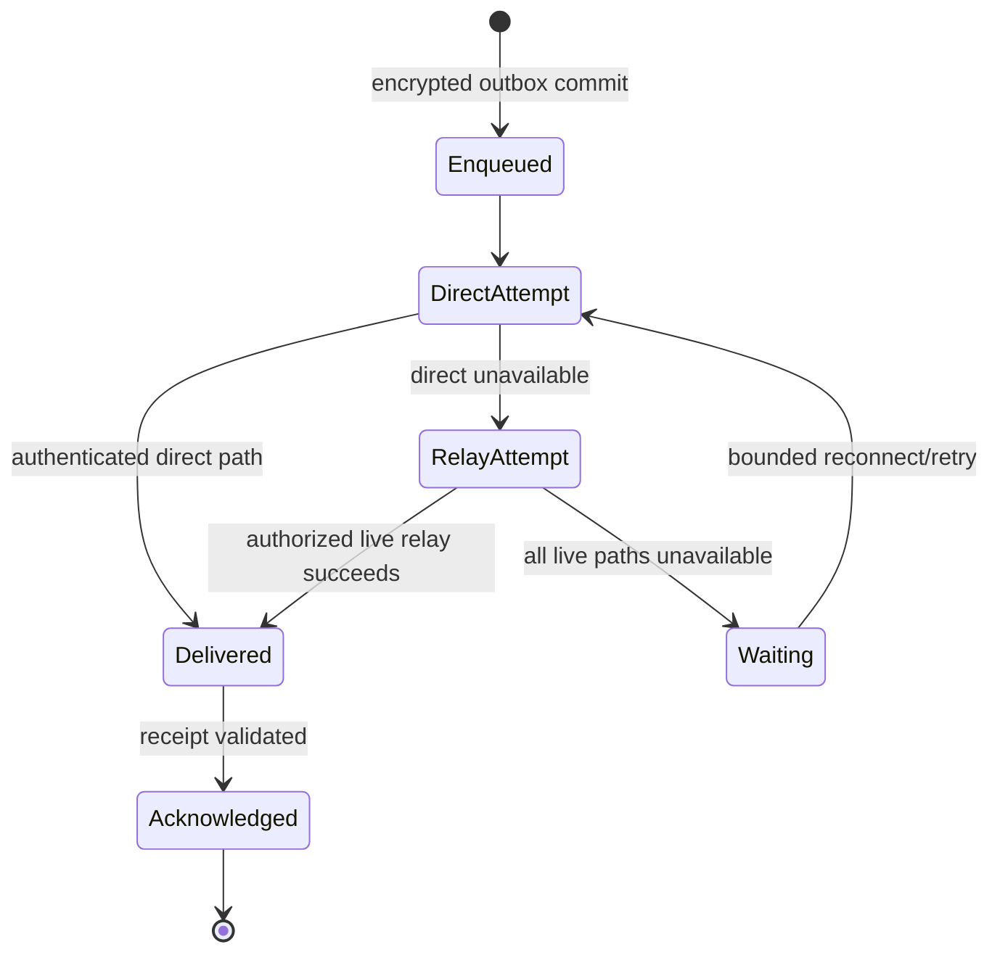

# Relay Fallback and Retry

Relays forward live end-to-end-protected traffic. They do not hold offline mail, authenticate the recipient on their own, or alter message identity. Multiple independently operated relay candidates may be selected and retried without inter-relay federation. Related: [[03 — Communication Flows/Communication Flows]], [[04 — Security and Identity/Security and Identity]], and [[05 — Data and State/Data and State]].