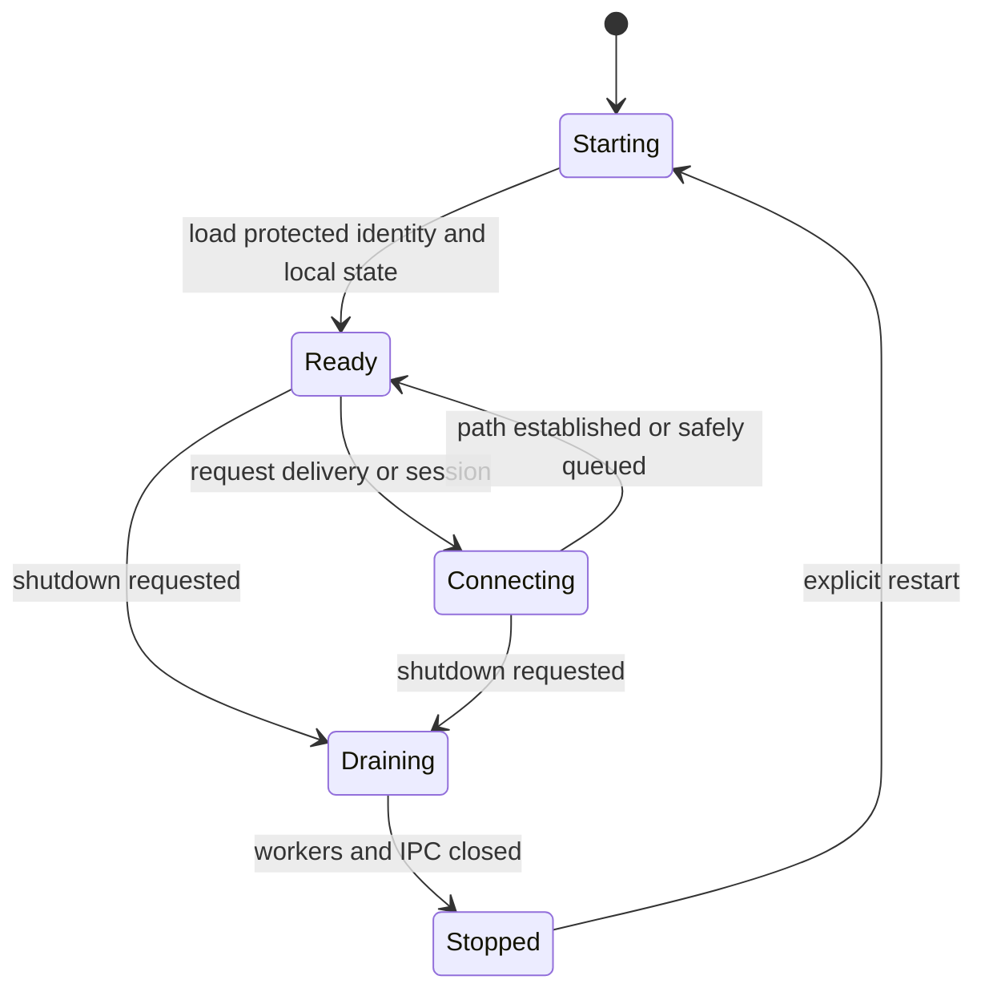

# Background Service Lifecycle

The manually started background service owns networking, local state, retry, and graceful shutdown. The CLI communicates through authenticated local IPC and must report queued, connecting, delivered, failed, and unavailable states truthfully. Related: [[06 — Runtime and Deployment/Runtime and Deployment]] and [[03 — Communication Flows/Communication Flows]].