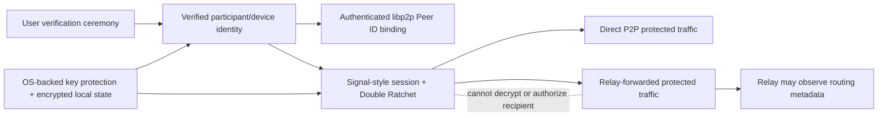

# Security and Identity

## Trust boundaries

## Security model

- One participant has one active device in M1.
- Explicit fingerprint verification is required before private sends.
- The verified device identity binds to the authenticated libp2p Peer ID for direct and relayed sessions.
- Application plaintext is decrypted only at intended endpoints.
- Relays forward protected live traffic and may observe limited routing metadata; they are not recipient authorities or offline mailboxes.
- Identity key changes require reverification.
- Local identity material and SQLite state require OS-backed/local protection; plaintext key fallbacks are not allowed.

Related: [[03 — Communication Flows/Contact Verification]], [[02 — Module Architecture/Module Architecture]], [[05 — Data and State/Data and State]], and [[06 — Runtime and Deployment/Runtime and Deployment]].