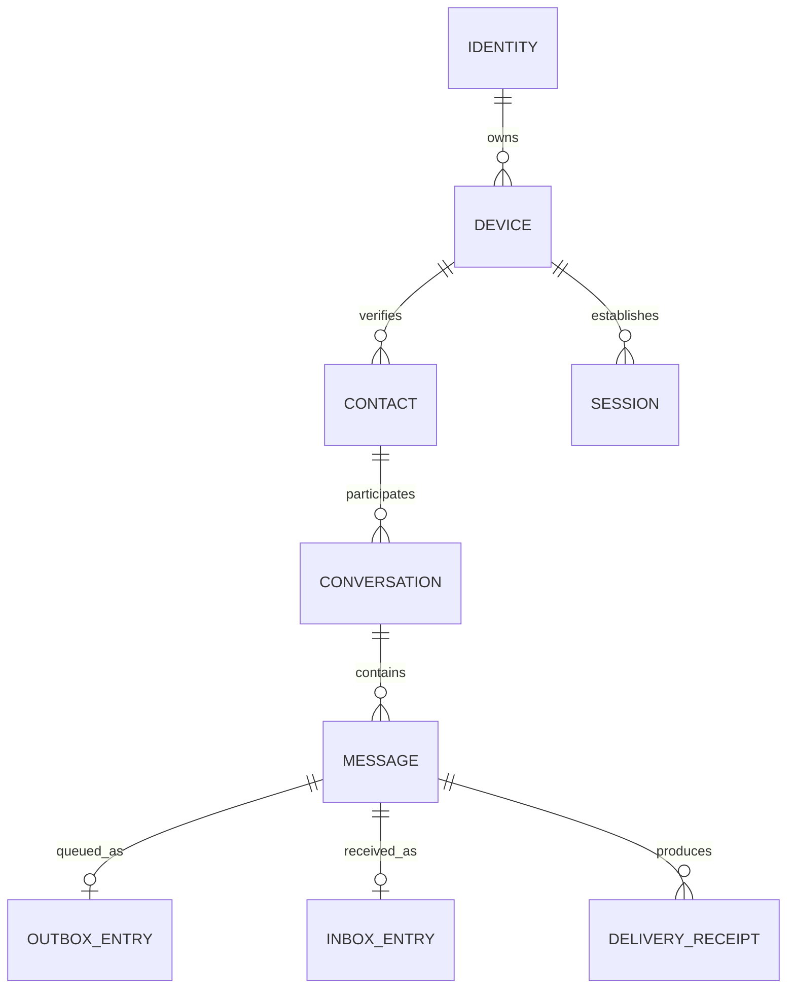
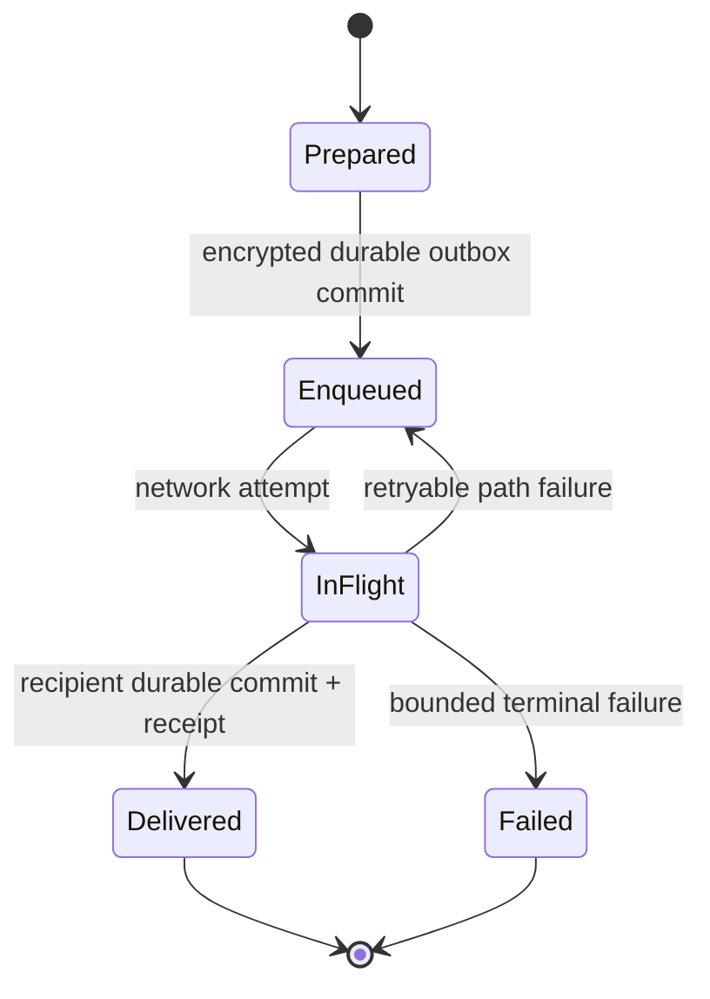

# Data and State

No database schema or persistence implementation exists in the current repository. This is the intended durable-state model from the approved architecture.

## Conceptual entities

## Message state

The recipient validates authorization, device binding, E2EE, protocol bounds, and content binding before atomically committing inbox, deduplication, ordering, receipt, and history facts. Same-ID duplicates are re-acknowledged without redisplay; same-ID conflicting content is rejected. Related: [[03 — Communication Flows/Communication Flows]], [[03 — Communication Flows/Relay Fallback and Retry]], and [[02 — Module Architecture/Module Architecture]].