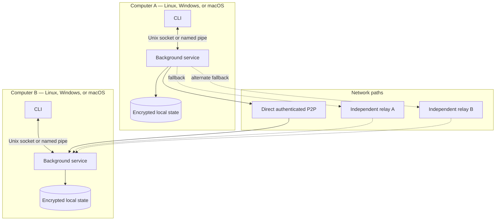

# Runtime and Deployment

## Deployment topology

## Runtime responsibilities

- The service is manually started and owns networking, durable state, sessions, retries, and shutdown.
- Linux and macOS use Unix domain sockets for local IPC; Windows uses named pipes.
- Direct P2P is preferred, with QUIC preferred and TCP available as an alternative within the approved design.
- Supported NAT traversal is attempted; universal reachability is not assumed.
- Multiple independently operated relays provide live fallback without inter-relay federation.
- Shutdown drains or safely persists work without claiming delivery that was not acknowledged.

Related: [[03 — Communication Flows/Service Lifecycle]], [[01 — System Architecture/System Boundaries]], and [[07 — Implementation Map/Implementation Map]].