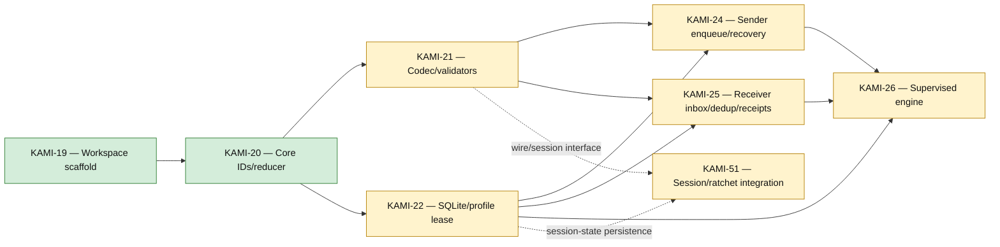

# Core, Protocol, and Storage

[[Implementation Map]] · [[Milestone 1 Dependency Graph]]

Parallel start: KAMI-21 and KAMI-22 can proceed after KAMI-20. KAMI-24 and KAMI-25 converge on the supervised engine after their explicit prerequisites.

Jira links: [KAMI-19](https://pql7227.atlassian.net/browse/KAMI-19) · [KAMI-20](https://pql7227.atlassian.net/browse/KAMI-20) · [KAMI-21](https://pql7227.atlassian.net/browse/KAMI-21) · [KAMI-22](https://pql7227.atlassian.net/browse/KAMI-22) · [KAMI-24](https://pql7227.atlassian.net/browse/KAMI-24) · [KAMI-25](https://pql7227.atlassian.net/browse/KAMI-25) · [KAMI-26](https://pql7227.atlassian.net/browse/KAMI-26)
