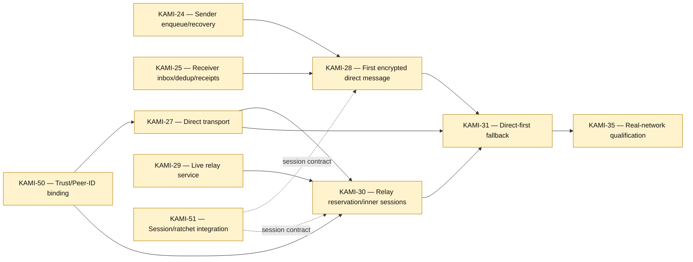

# Message Delivery, Transport, and Relays

[[Implementation Map]] · [[Milestone 1 Dependency Graph]]

The same logical message crosses direct and relay paths; transport success is not recipient delivery. KAMI-31 is the integration gate for automatic direct-first fallback.

Jira links: [KAMI-24](https://pql7227.atlassian.net/browse/KAMI-24) · [KAMI-25](https://pql7227.atlassian.net/browse/KAMI-25) · [KAMI-27](https://pql7227.atlassian.net/browse/KAMI-27) · [KAMI-28](https://pql7227.atlassian.net/browse/KAMI-28) · [KAMI-29](https://pql7227.atlassian.net/browse/KAMI-29) · [KAMI-30](https://pql7227.atlassian.net/browse/KAMI-30) · [KAMI-31](https://pql7227.atlassian.net/browse/KAMI-31)
