# KAMI Epic Hierarchy Map

[[Implementation Map]] · Jira snapshot: 2026-10-19T02:02:28-04:00

Parent/Epic membership is shown with hierarchy arrows only. It is not a blocking dependency.

```mermaid
flowchart TD
  E1["KAMI-1 — Product contracts and release governance"]
  E2["KAMI-2 — FM identity, trust, and local protection"]
  E3["KAMI-3 — FM protocol, delivery facts, and local durability"]
  E4["KAMI-4 — FM direct transport and live relay fallback"]
  E5["KAMI-5 — FM CLI, diagnostics, and qualification"]
  E6["KAMI-6 — Asynchronous delivery, authorization, and organization foundation"]
  E7["KAMI-7 — Groups and encrypted artifacts"]
  E8["KAMI-8 — Harness adapters and governed tasks"]
  E9["KAMI-9 — Operations, deployment, and full-v0.1 qualification"]

  E2 -->|parent| T23["KAMI-23 — Protected identity and key custody"]
  T23 -->|parent| T50["KAMI-50 — Contact trust and Peer-ID binding"]
  E2 -->|parent| T51["KAMI-51 — Authenticated sessions and ratchet persistence"]

  E3 -->|parent| T21["KAMI-21 — Bounded codec and validators"]
  E3 -->|parent| T22["KAMI-22 — Encrypted SQLite and profile lease"]
  E3 -->|parent| T24["KAMI-24 — Sender enqueue and recovery"]
  E3 -->|parent| T25["KAMI-25 — Receiver inbox, dedup, receipts"]
  E3 -->|parent| T26["KAMI-26 — Supervised Tokio engine"]
  E3 -->|parent| T28["KAMI-28 — First authenticated direct message"]

  E4 -->|parent| T27["KAMI-27 — Authenticated direct transport"]
  E4 -->|parent| T29["KAMI-29 — Default-deny live relay"]
  E4 -->|parent| T30["KAMI-30 — Relay reservation and inner sessions"]
  E4 -->|parent| T31["KAMI-31 — Direct-first relay fallback"]

  E5 -->|parent| T32["KAMI-32 — IPC, CLI, diagnostics, shutdown"]
  E5 -->|parent| T33["KAMI-33 — Rust harness and evidence recorder"]
  E5 -->|parent| T34["KAMI-34 — Local correctness/resilience matrix"]
  E5 -->|parent| T35["KAMI-35 — Real-network qualification"]
  E5 -->|parent| T36["KAMI-36 — Regression and failure-state matrix"]
  E5 -->|parent| T37["KAMI-37 — Privacy and ciphertext-forwarding"]
  E5 -->|parent| T38["KAMI-38 — Test contract and traceability (Done)"]
  E5 -->|parent| T39["KAMI-39 — Independent M1 evidence review"]

  classDef epic fill:#243b53,stroke:#9fb3c8,color:#fff
  classDef todo fill:#fff3cd,stroke:#b58105,color:#111
  classDef done fill:#d4edda,stroke:#2e7d32,color:#111
  class E1,E2,E3,E4,E5,E6,E7,E8,E9 epic
  class T21,T22,T23,T24,T25,T26,T27,T28,T29,T30,T31,T32,T33,T34,T35,T36,T37,T39,T50,T51 todo
  class E1,E6,E7,E8,E9,T38 done
```

Jira issue links: [KAMI-1](https://pql7227.atlassian.net/browse/KAMI-1) · [KAMI-2](https://pql7227.atlassian.net/browse/KAMI-2) · [KAMI-3](https://pql7227.atlassian.net/browse/KAMI-3) · [KAMI-4](https://pql7227.atlassian.net/browse/KAMI-4) · [KAMI-5](https://pql7227.atlassian.net/browse/KAMI-5) · [KAMI-6](https://pql7227.atlassian.net/browse/KAMI-6) · [KAMI-7](https://pql7227.atlassian.net/browse/KAMI-7) · [KAMI-8](https://pql7227.atlassian.net/browse/KAMI-8) · [KAMI-9](https://pql7227.atlassian.net/browse/KAMI-9)
