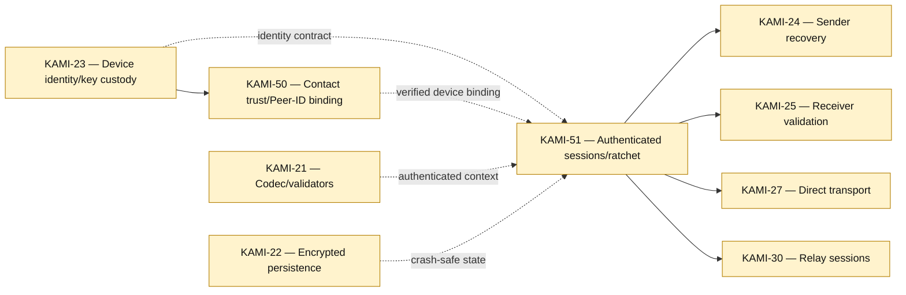

# Identity, Trust, and E2EE Sessions

[[Implementation Map]] · [[Milestone 1 Dependency Graph]]

KAMI-22 → KAMI-23 remains a visible Jira inconsistency in the complete graph; it is intentionally absent here as an engineering prerequisite.

Jira links: [KAMI-23](https://pql7227.atlassian.net/browse/KAMI-23) · [KAMI-50](https://pql7227.atlassian.net/browse/KAMI-50) · [KAMI-51](https://pql7227.atlassian.net/browse/KAMI-51) · [KAMI-21](https://pql7227.atlassian.net/browse/KAMI-21) · [KAMI-22](https://pql7227.atlassian.net/browse/KAMI-22)
