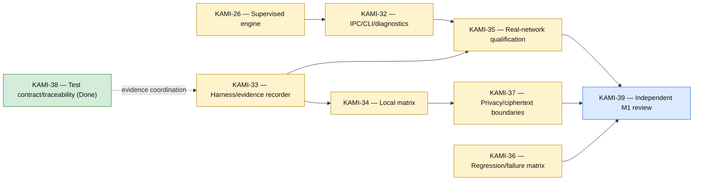

# Integration, Runtime, and Qualification

[[Implementation Map]] · [[Milestone 1 Dependency Graph]]

KAMI-39 is the final evidence gate. Qualification claims must remain bounded to the actually tested OS, network, transport, and relay configurations.

Jira links: [KAMI-26](https://pql7227.atlassian.net/browse/KAMI-26) · [KAMI-32](https://pql7227.atlassian.net/browse/KAMI-32) · [KAMI-33](https://pql7227.atlassian.net/browse/KAMI-33) · [KAMI-34](https://pql7227.atlassian.net/browse/KAMI-34) · [KAMI-35](https://pql7227.atlassian.net/browse/KAMI-35) · [KAMI-36](https://pql7227.atlassian.net/browse/KAMI-36) · [KAMI-37](https://pql7227.atlassian.net/browse/KAMI-37) · [KAMI-38](https://pql7227.atlassian.net/browse/KAMI-38) · [KAMI-39](https://pql7227.atlassian.net/browse/KAMI-39)
