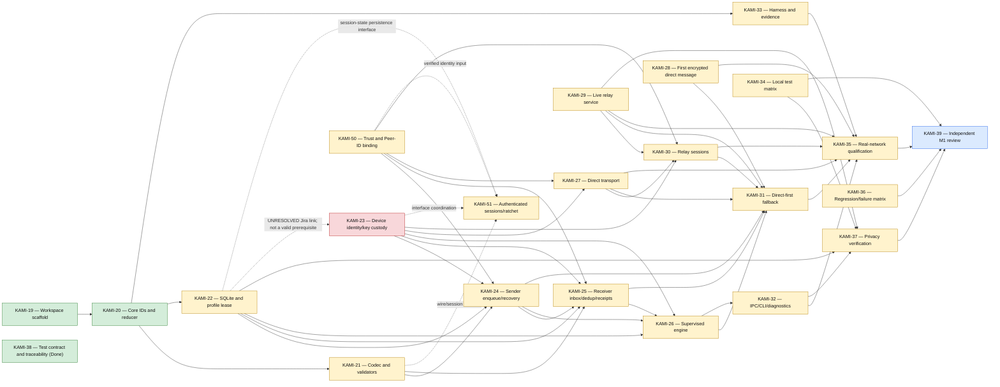

# Milestone 1 Jira Dependency Graph

[[Implementation Map]] · Jira snapshot: 2026-10-19T02:02:28-04:00

Solid arrows are current Jira `Blocks` links. The red dotted arrow is intentionally not accepted as a prerequisite.

## Navigation

[[Core Protocol Storage]] · [[Identity Trust E2EE]] · [[Delivery Transport Relays]] · [[Integration Runtime Qualification]]

Jira links: [KAMI-21](https://pql7227.atlassian.net/browse/KAMI-21) · [KAMI-22](https://pql7227.atlassian.net/browse/KAMI-22) · [KAMI-23](https://pql7227.atlassian.net/browse/KAMI-23) · [KAMI-50](https://pql7227.atlassian.net/browse/KAMI-50) · [KAMI-51](https://pql7227.atlassian.net/browse/KAMI-51)
