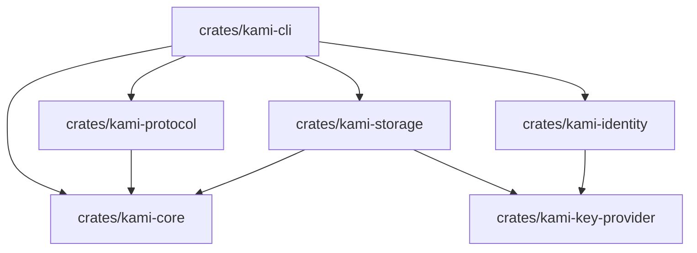

# Kami Code Analysis Home

Welcome to the **Kami Code Analysis** knowledge base. This documentation is designed to help you explore, learn, and track the Rust source code across all crates in the Kami project.

Whether you are new to Rust or learning the Kami architecture, these notes break down every module, struct, enum, and function into plain, beginner-friendly English with direct links to the source files.

---

## What is Kami?

**Kami** is a communication-first platform built for secure, end-to-end encrypted messaging between:
- Humans and humans
- Humans and AI agents
- AI agents and AI agents

Kami is built in **Rust** using an architecture-first approach. For Milestone 1 (M1), the goal is private, reliable one-to-one text messaging between two CLI endpoints across Linux, macOS, and Windows.

---

## Milestone 1 Status Overview

Milestone 1 focuses on four critical layers:
1. **Domain Core**: Pure data structures, message identity, deduplication logic, and delivery state tracking.
2. **Wire Protocol**: Strict, bounded, zero-allocation-on-bad-input Protobuf serialization.
3. **Key Custody & Identity**: OS keyring integration (Linux Secret Service, macOS Keychain, Windows Credential Manager) and secure database key generation.
4. **Encrypted Storage**: SQLCipher-encrypted SQLite database with profile directory leasing, outbox retries, inbox deduplication, and message gap-ordering.
5. **Background Service & CLI**: The client interface and background daemon (currently in scaffolding phase).

### Overall M1 Progress: **~68%**
*Whole-project progress: **Not estimable** (broader roadmap items like multi-device, offline relays, and agent harness bridges are not yet fully specified).*

---

## Workspace Crates Map

| Crate Note | Primary Purpose | Milestone 1 Status | Test Status |
| :--- | :--- | :--- | :--- |
| [[kami-core]] | Pure domain facts, state machine transitions, and queue limits (no I/O or dependencies). | **100%** complete | Verified (unit tests, 5 proptests, 7 golden vectors, 99.6% coverage) |
| [[kami-protocol]] | Bounded Protobuf encoding/decoding and structural frame validation (up to 64 KB). | **95%** complete | Verified (unit tests, vectors, fuzz/proptests, memory probe) |
| [[kami-key-provider]] | Synchronous database key custody contract and memory-zeroizing key type. | **100%** complete | Verified (unit tests, fault injection, restart/loss tests) |
| [[kami-identity]] | OS keyring integration (Secret Service, Keychain, Credential Manager) & Ed25519 custody. | **85%** complete | Verified on Linux; Windows/macOS compiled & Clippy-checked |
| [[kami-storage]] | SQLCipher encrypted local database, profile filesystem leasing, outbox/inbox queues. | **90%** complete | Verified on Linux (WAL, kill/restart, concurrency, schema) |
| [[kami-cli]] | Command-line client and background service daemon. | **15%** complete (scaffold) | Scaffold tests only; IPC and commands pending |

---

## Architecture & Dependency Flow

---

## How to Navigate These Notes

Each crate note is organized into three beginner-friendly sections:
1. **Overview**: Explains the crate's purpose, what real-world problem it solves in Kami, its dependencies, and relevant Jira/roadmap requirements.
2. **Source Code Explanation**: Hierarchical breakdown of every module, struct, enum, and method. Explains what each type represents, why Kami needs it, key fields, and how functions work with their error conditions and security implications.
3. **Completion & Verification**: An evidence-based scorecard showing implemented behavior, verified tests, missing behavior, known limitations, and exact `cargo` commands you can run to test the code yourself.

Explore the individual crate documentation:
- [[kami-core]]: Pure message identity and delivery state machine
- [[kami-protocol]]: Strict Protobuf network frames
- [[kami-key-provider]]: Injected encryption key contracts
- [[kami-identity]]: OS keyrings and device identity enrollment
- [[kami-storage]]: Encrypted SQLCipher database and worker queues
- [[kami-cli]]: User commands and daemon scaffold

---

## Analysis Baseline
- **Git Branch**: `protocol-storage`
- **Git Commit**: `732156f6f13cbbe4d897f663c1f2546182619704`
- **Toolchain**: Rust 2021 Edition / Cargo workspace
